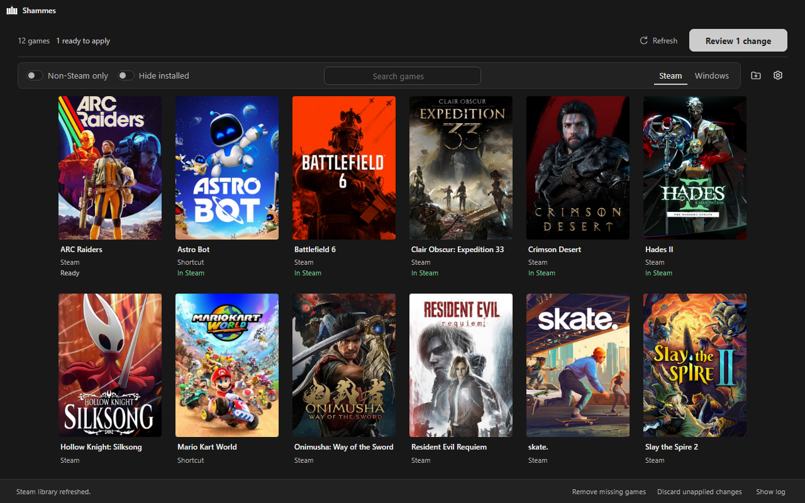

# Shammes

Shammes is a Windows app made to customize Steam game artwork using SteamGridDB.

It can also bulk add games as non-Steam shortcuts (with artwork) or desktop shortcuts, set game artwork as your windows wallpaper, and change icons for desktop and Start menu shortcuts.

<p align="center">
  <a href="docs/screenshots/steam-library.png"></a>
</p>

## Download

[Download Shammes for Windows](https://github.com/Kirkland-Pickles/shammes/releases/latest)
 
## How to use

*For games outside Steam:*  

use , choose a game’s folder or a folder containing multiple games. Review the name, launcher and game match before adding them to Steam.


*For Steam games:* 
  
Your Steam library appears automatically. Open a game to change its artwork.
Add [SteamGridDB API key](https://www.steamgriddb.com/profile/preferences/api) to browse artwork. Or use your own images without a key.

Choose artwork for each game, then save your choices and use **Review changes** to apply them together. Steam will close while changes are applied and reopen afterwards.

## Undoing changes

Use **Purge** to undo the changes made by the app. It uses a saved
record of those changes for this purpose. Steam's shortcut
file is backed up before anything is changed.

Do this before using **Delete app data** if you want the changes undone. Deleting
the app data removes that saved record too.

## Building

Install Node.js LTS. Clone this repository, then open a terminal in the repository folder and run:

```bat
npm ci
npm run build
```

The installer will be in `dist\`.

## Help

[Open an issue](https://github.com/Kirkland-Pickles/shammes/issues) for bugs
or suggestions.

## Credits

- Game matching and artwork: https://www.steamgriddb.com/
- Layout inspiration and artwork-selection flow: https://github.com/SteamGridDB/decky-steamgriddb

